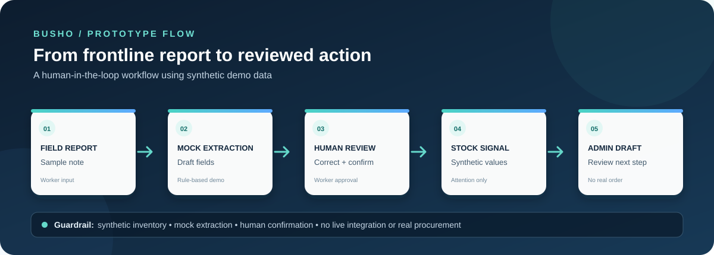

# BUSHO: Bottom-Up Smart Health Orchestrator

BUSHO is a dependency-free browser prototype for first-mile health reporting and medicine-stock coordination. It demonstrates how frontline field notes can be structured through **mock extraction**, reviewed by a human operator, compared with synthetic inventory signals, and used to prepare administrator-reviewed replenishment drafts.

> **Prototype limitation:** This is a demo, not a production healthcare system. It uses synthetic sample data, client-side logic, and browser `localStorage`. It does not implement production AI inference, voice transcription, authentication, a shared backend/database, live government inventory integration, or real ordering. Do not enter real patient-identifiable or sensitive health information.

## Demo at a glance



*Prototype flow: field report → mock extraction → human review → synthetic inventory signal → administrator-reviewed draft. This diagram describes the demo workflow, not a live healthcare integration.*

- **Live demo:** https://project1busho.vercel.app/
- **Automated extraction tests:** [TESTS_AUTOMATED.md](TESTS_AUTOMATED.md) · [test file](tests/extraction.test.cjs)
- **Demo walkthrough:** [DEMO_SCENARIOS.md](DEMO_SCENARIOS.md)

## Workflow states

- **Reported Health Trend:** A raw field signal that needs review.
- **Worker-Verified Operational Record:** Structured information confirmed by a human operator.
- **Administrative Replenishment Action:** A draft that remains in the demo workflow; it does not place a real order.

The original report remains visible alongside proposed structured data to support human review.

## Project structure

| File | Purpose |
| --- | --- |
| `index.html` | Application shell and Worker/Administrator views |
| `styles-v2.css` | Responsive styles and visual system |
| `app-v2.js` | Mock extraction, validation, sample inventory logic, workflow transitions, and browser-local persistence |
| `server.mjs` | Dependency-free Node.js static HTTP server |
| `ARCHITECTURE.md` | Current architecture, data flow, boundaries, and proposed production evolution |
| `TESTING.md` | Manual demo smoke-test checklist |
| `LICENSE` | MIT License |
| `terms.html`, `privacy.html` | Pre-pilot draft documents; not a substitute for legal or privacy review |

Legacy v1 files are retained for archival reference; the active application uses the v2 assets.

## Prerequisites

- Node.js 18 or newer
- A modern browser

## Run locally

1. Clone or download this repository.
2. Open a terminal in the repository folder.
3. Run:

   ```sh
   node server.mjs
   ```

4. Open **http://127.0.0.1:4173** in your browser.

Stop the server with `Ctrl+C`.

## Guided demo

1. Start in the Worker view and use the sample routine report.
2. Run the extraction action to see a structured draft from mock extraction.
3. Review the fields and confirm the record.
4. Switch to the Administrator view to inspect the synthetic inventory signal.
5. Review the replenishment draft workflow; no real order is placed.
6. Use **Reset demo data** to return to the initial synthetic state.

See [TESTING.md](TESTING.md) for manual smoke checks and [ARCHITECTURE.md](ARCHITECTURE.md) for the system boundaries.

## Safety and future work

Any real-world pilot would require validation with health workers and administrators, secure authentication and access controls, a protected backend, audit logging, privacy/security review, validated extraction with human approval, and formally approved integration with relevant inventory systems. The prototype has not been field-validated and makes no measured impact claims.
