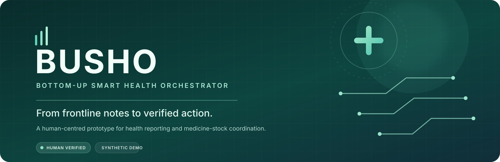
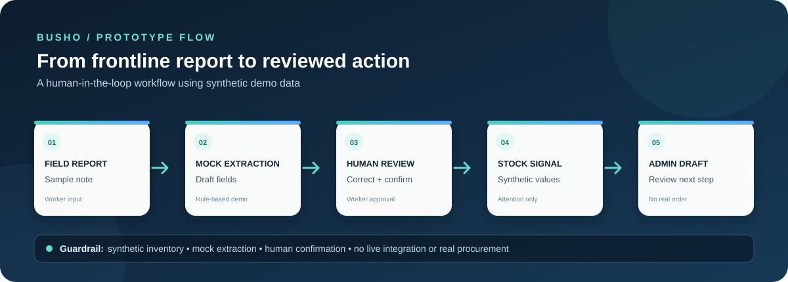

# BUSHO — Bottom-Up Smart Health Orchestrator

<p align="center">
  
</p>

<p align="center">
  <strong>A first-mile health reporting and medicine-stock coordination prototype.</strong><br />
  Frontline notes become structured drafts. People review, correct and decide what happens next.
</p>

<p align="center">
  <a href="https://busho.de5.net"><strong>Open BUSHO ↗</strong></a>
  &nbsp;·&nbsp;
  <a href="https://project1busho.vercel.app/">Vercel deployment</a>
  &nbsp;·&nbsp;
  <a href="https://github.com/kirtanswamy/BUSHO/issues">Report an issue</a>
</p>

> **Prototype, not a production health service.** BUSHO currently uses synthetic sample data, browser-side logic and `localStorage`. Extraction is simulated/rule-based, voice transcription and production AI inference are not implemented, and no real inventory system or ordering service is connected. Do not enter real patient-identifiable or sensitive health information.

---

## The idea

Frontline health workers often notice changes in community health needs and medicine availability before those observations reach decision-makers. BUSHO explores a simple, human-controlled path for turning everyday field notes into information that can be reviewed and acted on responsibly.

## How the prototype works

<p align="center">
  
</p>

| Stage | What happens | Control |
| --- | --- | --- |
| **01 · Report** | A worker enters a field update in ordinary language | Worker |
| **02 · Draft** | BUSHO proposes structured fields beside the original note | Provisional only |
| **03 · Verify** | The worker reviews, edits and confirms the information | Worker |
| **04 · Review** | A supervisor inspects synthetic stock signals and a replenishment draft | Administrator |

**The key principle:** a reported trend is not a diagnosis, an extracted value is not a verified fact, and a replenishment draft is not an order.

## What you can explore

- **Worker console** — enter or select a synthetic field report.
- **Structured extraction draft** — inspect proposed fields while keeping the original note visible.
- **Human verification** — correct and confirm a record before it is treated as verified in the demo.
- **Administrator overview** — inspect illustrative health-trend and medicine-stock signals.
- **Replenishment workflow** — prepare an administrator-reviewed draft; no purchase order is sent.
- **Browser-local demo state** — explore the workflow and reset it to the starting state.

## Try the live demo

<blockquote>
  <strong>Live prototype:</strong> <a href="https://busho.de5.net">https://busho.de5.net</a><br />
  <strong>Vercel deployment:</strong> <a href="https://project1busho.vercel.app/">project1busho.vercel.app</a>
</blockquote>

Use the built-in sample scenarios. All names, reports, facilities, counts and inventory values shown in the demo are illustrative.

## Run locally

**Requirements:** Node.js 18 or newer and a modern browser.

```bash
git clone https://github.com/kirtanswamy/BUSHO.git
cd BUSHO
node server.mjs
```

Open **http://127.0.0.1:4173**. Stop the server with `Ctrl+C`.

The current prototype is plain HTML, CSS and JavaScript. It has no frontend build step or runtime package installation requirement.

## Project map

| Path | Purpose |
| --- | --- |
| `index.html` | Application shell and Worker / Administrator views |
| `styles-v2.css` | Responsive visual system and layout |
| `app-v2.js` | Demo state, mock extraction, validation and workflow transitions |
| `server.mjs` | Small Node.js server for local preview |
| `assets/` | Workflow and repository visuals |
| `tests/` | Automated extraction tests |
| `ARCHITECTURE.md` | Components, data flow and trust boundaries |
| `IMPACT_AND_IMPLEMENTATION.md` | Intended impact, risks, phased implementation and proposed evaluation |
| `DEMO_SCENARIOS.md` | Repeatable synthetic demo scenarios |
| `TESTING.md` | Manual smoke-test checklist |
| `terms.html`, `privacy.html` | Pre-pilot draft documents; not legal or privacy certification |

## Documentation

| Guide | What you'll find |
| --- | --- |
| [Architecture](ARCHITECTURE.md) | Current implementation, data flow, boundaries and future architecture |
| [Impact & implementation plan](IMPACT_AND_IMPLEMENTATION.md) | Intended users, safeguards, risks, phases and proposed metrics |
| [Demo scenarios](DEMO_SCENARIOS.md) | Routine report, ambiguous report and inventory walkthroughs |
| [Testing guide](TESTING.md) | Manual checks to run before presenting |
| [Terms](terms.html) · [Privacy](privacy.html) | Draft pre-pilot notices |

## Safety, privacy and limitations

- **Synthetic data only.** Never enter real patient details or sensitive health information.
- **No diagnosis.** A symptom mention is a reported signal for review, not a clinical conclusion or outbreak declaration.
- **Human confirmation.** Proposed fields remain provisional until reviewed by a person.
- **No automatic procurement.** Replenishment is a draft only.
- **No production access controls.** Authentication, role-based permissions, shared backend persistence, audit logging and production security controls are not implemented in this prototype.
- **No field validation or measured impact claims.** The workflow needs co-design and supervised testing with intended users before any pilot.

See [Architecture](ARCHITECTURE.md) and [Impact & Implementation](IMPACT_AND_IMPLEMENTATION.md) for details.

## Roadmap

1. Validate the reporting workflow with frontline workers and supervisors.
2. Complete native-speaker review of all language content before operational use.
3. Build a secure backend, authentication, role-based access and audit logging.
4. Evaluate any extraction model against representative, approved data while retaining human confirmation.
5. Integrate authoritative inventory sources only with formal approval and clear data ownership.
6. Run a supervised pilot with agreed safety, privacy and evaluation criteria.

These are proposed next steps, not completed capabilities.

## Contributing

Contributions that improve clarity, accessibility, reliability and safety are welcome. Please use synthetic examples only and avoid adding unsupported product or impact claims. Contribution and security guidance will be published as the repository's contributor pack is reviewed and merged.

## Project identity

**BUSHO** stands for **Bottom-Up Smart Health Orchestrator**.

The project explores alignment with **UN Sustainable Development Goal 3 — Good Health and Well-Being** and **SDG 10 — Reduced Inequalities**. This is an intended alignment, not a claim of measured progress.

---

<p align="center">
  <strong>Built as a prototype for responsible, human-centred public-health coordination.</strong><br />
  <sub>AI may assist with structuring information; people remain responsible for verification and action.</sub>
</p>
