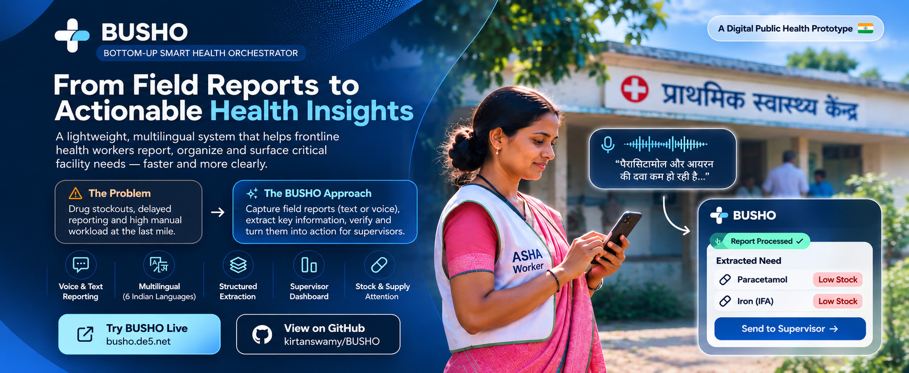
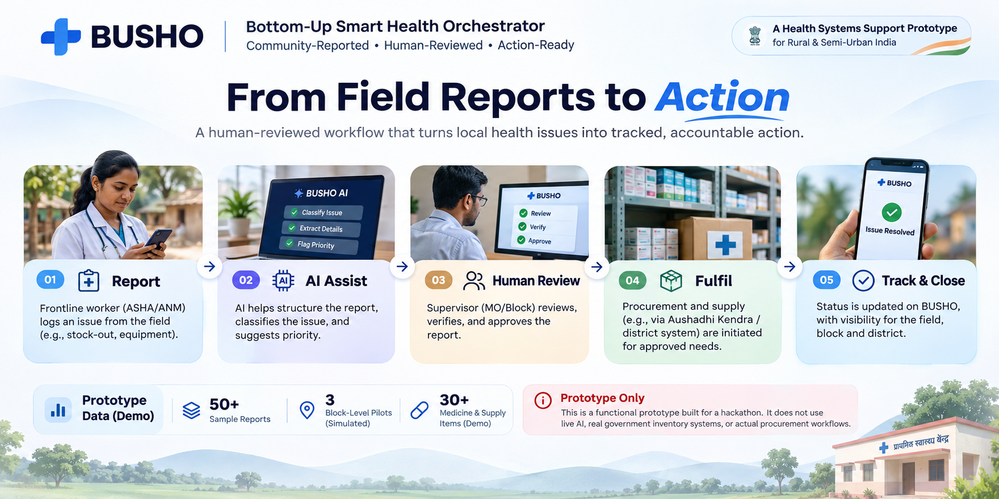

<!-- BUSHO repository landing page. Keep all claims aligned with the working prototype. -->

 

---

## About BUSHO

**BUSHO (Bottom-Up Smart Health Orchestrator)** is a browser-based public-health workflow prototype that explores how frontline health-worker reports can be structured, verified, and surfaced to supervisors—without automating clinical decisions or procurement.

It focuses on one hand-off: **community → frontline worker → facility / supervisor**.

<table>
  <tr>
    <td width="25%" valign="top">

### ◉ Capture

Report needs via text or voice in local languages.

</td>
    <td width="25%" valign="top">

### ◈ Extract

Convert unstructured reports into structured, editable draft fields.

</td>
    <td width="25%" valign="top">

### ◎ Organize

Keep the original report visible and put human verification first.

</td>
    <td width="25%" valign="top">

### ↗ Act

Highlight sample stock risks and prepare supervisor-reviewed drafts.

</td>
  </tr>
</table>

 > **Prototype boundary:** BUSHO uses mock rule-based extraction and synthetic demonstration content. Worker reports, report items, review decisions and audit events are designed to persist through authenticated Supabase workflows; browser-local storage is limited to per-user draft recovery. The connected project currently has no operational users, facilities, assignments or reports, so a real multi-user workflow has not yet been demonstrated. BUSHO is not a live health system, does not diagnose, does not place medicine orders, and does not connect to government inventory systems.

## The gap

A health worker may notice a local pattern, a follow-up need, or a medicine running low. But a useful signal can lose time and context as it moves from a field note into registers, calls, spreadsheets, and administrative workflows.

This is not a claim that India has no digital health or supply-chain systems. Public programmes and state systems already exist. BUSHO asks a narrower question:

> Can the first-mile report become easier to structure, verify, and route—while fitting around existing facility and government systems rather than replacing them?

| First-mile challenge | What BUSHO prototypes |
|---|---|
| Notes arrive in inconsistent free-text formats | A structured draft beside the original report |
| Details can be missed or misread | Human correction and confirmation before verification |
| Stock concerns may need escalation | A supervisor-facing attention signal using sample inventory |
| A proposed next step can be mistaken for an order | A reviewable draft; no automatic procurement |

## How it works

1. **Report** — a frontline worker enters a short field update in plain language.
2. **Structure** — the prototype proposes fields using mock, rule-based extraction.
3. **Verify** — the worker inspects, edits, and confirms the proposed record. The original report remains visible.
4. **Review** — a supervisor sees the verified operational record alongside a synthetic stock attention signal.
5. **Prepare** — the supervisor reviews a replenishment draft. **No real order is placed.**

### Safety principles

- A draft is not a fact. A reported trend is not a diagnosis.
- Human confirmation is required before a record is treated as verified.
- Stock signals are operational prompts, not clinical recommendations.
- Replenishment is a draft for review—not an automatic order.
- Synthetic content is for demonstration only. Authenticated worker drafts and reports use the development Supabase project; local storage is a per-user recovery checkpoint, not a shared operational source of truth. Never enter real patient-identifiable or sensitive health information.

## Why this workflow matters

These sources establish that medicine availability and frontline information workflows are real areas of concern. They do **not** prove that BUSHO has solved them.

<strong>Chhattisgarh — historical public-facility availability finding</strong>

A study covering **100 public health facilities across 15 districts** and **1,290 prescriptions** in Chhattisgarh reported that **58.28% of prescribed generic medicines included in the state's essential-drug list were available** to patients during the study period (2013–14).

This is a historical, study-specific finding—not a current statewide estimate and not evidence of BUSHO's impact.

- [Study record — PubMed](https://pubmed.ncbi.nlm.nih.gov/29915750/)
- [State Health Resource Centre — free-drug and diagnostics studies](https://www.shsrc.org/StudiesFreeDrugandDiagnostics.html)

<strong>India — medicine availability varies across settings</strong>

A 2024 review of 11 studies reported public-sector medicine availability estimates ranging from **17% to 51%** across the included studies. The range reflects different settings and methods; it is not one national estimate.

- [2024 review — PubMed Central](https://pmc.ncbi.nlm.nih.gov/articles/PMC11174260/)

<strong>Frontline digital workflows — usability and data burden</strong>

A 2022 qualitative study in *BMJ Open* described frontline workers' experiences with digitised health reporting, including multiple forms and registers, data-entry backlogs, and data-quality challenges.

The lesson is not “add another app.” It is to test whether a workflow reduces friction and duplicate effort in the local context.

- [BMJ Open study — PubMed](https://pubmed.ncbi.nlm.nih.gov/35140145/)

<strong>Existing systems — BUSHO is not a replacement</strong>

India and Chhattisgarh have existing health-information and medicine-supply initiatives. Any future BUSHO pilot must map the real workflow and approved interfaces first.

- [16th Common Review Mission report (2024) — NHSRC](https://nhsrcindia.org/sites/default/files/2025-03/16th%20CRM%20Report%20%282024%29_0.pdf)
- [Free Drugs Service Initiative — NHSRC](https://nhsrcindia.org/free-drugs-service-initiative-0)

## What exists in the development branch

| Implemented in code / database | Still pending or not validated |
|---|---|
| Chhattisgarh LGD directory snapshot (33 districts, 146 unique block codes) | Verified facility registry and real workforce assignments |
| Supabase schema, role-scoped RLS policies, column grants and workflow transition guards | Live Auth users and operational records |
| Worker report submission adapter, server-backed history and correction resumption | Real two-worker / two-supervisor, two-facility end-to-end validation |
| Supervisor inbox, report detail, review decisions and append-only event timeline | Live supervisor workflow demonstration with provisioned accounts |
| Administrator provisioning policy, invitation service code and gated admin workspace | Deployment and live verification of the `provision-user` Edge Function |
| Facility registry staging, batch review, scoped verification and audit RPCs in the development migration | Live schema migration, deployed `facility-registry` Edge Function and a current official Chhattisgarh facility export |
| Dated PMBJK reference snapshots kept separate from AAM / CGMSC | Live Kendra locations and external government API integrations |
| Mock, rule-based extraction with human correction | Production AI inference or clinical validation |
| Browser-native voice input and six interface languages | Native-speaker validation and a BUSHO-operated transcription service |
| Automated Node and PostgreSQL 17 database-contract tests | Field validation, measured outcomes and security sign-off |

**Live project boundary:** The connected Supabase project currently has no Auth users, profiles, facilities, workers, assignments, reports or audit records. The provisioning Edge Function is present in the development branch but is not deployed. No real workforce workflow has been demonstrated. Do not enter patient-identifiable information.

**Voice privacy:** Voice input uses the browser's speech-recognition service, which may send audio to the browser vendor. BUSHO does not store audio recordings. Manual text entry remains available. Do not speak names, phone numbers, diagnoses, government IDs, or other identifying patient details.

## Website portals

The development branch contains one public landing page and three separate role-gated workspaces:

- `/` — public product landing page.
- `/worker.html` — authenticated health-worker reporting, server-backed history and correction workflow.
- `/supervisor.html` — authenticated facility-scoped report inbox, human review and audit timeline.
- `/admin.html` — administrator-only account invitations and facility / geographic assignment.

Account roles and assignments are derived from the database, not browser-supplied metadata. New accounts are invited by an authorised administrator; users set their own password through the invitation link. The browser never receives the Supabase service-role / secret key.

**Release status:** These changes are on the draft pull request [#5](https://github.com/kirtanswamy/BUSHO/pull/5), not on the production branch. The production domain remains attached to `main`. Do not treat the current production website as the deployed version of these development-branch workflows.

## Medicine catalogue validation

The development branch includes a source-transcription validator. It checks provenance, annexure/facility-level consistency, source-row uniqueness and page bounds while refusing unreviewed normalized units or formulation fields. It outputs a staging-only validation report; it does not import to live Supabase.

Run: `node scripts/validate-medicine-catalogue.mjs data/medicine-catalogue/chhattisgarh-edl-2025-sample.json /tmp/edl-validation.json`.

## Medicine reference catalogue

The development branch adds a versioned, source-attributed medicine catalogue foundation. The first source is the Government of Chhattisgarh **Essential Drug List 2025**. The branch now contains verbatim source transcriptions of all **278 numbered EDL rows**: 172 PHC/PHC-AAM/UPHC entries and 106 SHC-AAM entries. All 10 annexure pages have been visually inspected and page-scoped text checks completed; one OCR spelling discrepancy was corrected to match the rendered PDF. This is source transcription reconciliation only—not pharmacist/CGMSC approval, normalized SKU mapping, a stock list, or permission to use the rows for prescribing or procurement. The original 24-row sample remains a clearly labelled starter sample. See the [medicine catalogue governance and audit status](docs/medicine-reference-catalogue.md), [278-row review queue](data/medicine-catalogue/chhattisgarh-edl-2025-review-queue.json), [source annotation register](data/medicine-catalogue/chhattisgarh-edl-2025-source-annotations.json), [authorised pharmacist review protocol](docs/edl-authorised-review-protocol.md), [278-row pharmacist review worksheet](data/medicine-catalogue/chhattisgarh-edl-2025-pharmacist-review-template.csv), the [172-row PHC-AAM/UPHC transcription](data/medicine-catalogue/chhattisgarh-edl-2025-phc-aam-source-transcription.json), the [106-row SHC-AAM transcription](data/medicine-catalogue/chhattisgarh-edl-2025-shc-aam-source-transcription.json), and the [source manifest](data/medicine-catalogue/chhattisgarh-edl-2025-source-manifest.json). The review decision validator must pass an authorised review batch before normalization is considered; live import remains separately disabled.

## Role and workflow blueprint

The current application roles are deliberately separate from health-worker cadre/designation. Read the [role, responsibility and permission blueprint](docs/role-responsibility-permission-blueprint.md) before extending permissions or building additional operational workflows. It defines the evidence boundaries, role matrix, server-side permission rules, synthetic reference scenario and field-validation questions. It is a product/engineering baseline, not a government-approved SOP.

## Before a real pilot

BUSHO is a **workflow prototype**, not a deployable healthcare product. A responsible next phase would be:

1. **Validate locally** — interview frontline workers, facility staff and supervisors; map actual paper, phone, HMIS and stock workflows.
2. **Check for duplication** — identify what existing systems already capture and where an approved hand-off is genuinely missing.
3. **Co-design and test** — use synthetic or properly de-identified scenarios first; test on low-end devices and unreliable connectivity.
4. **Build foundations** — secure authentication, role-based permissions, protected backend, audit logs, retention controls and security review.
5. **Validate technology** — evaluate extraction against a labelled dataset, obtain native-speaker translation review, and retain human approval.
6. **Run a supervised pilot** — measure reporting time, completeness, correction rate, duplicate-entry burden, escalation time, stockout duration and worker adoption against a baseline.

Potential pilot targets are hypotheses—not achieved results. No reduction in mortality, disease burden, or stock-outs is claimed.

## What success should mean

A useful pilot should demonstrate that BUSHO helps workers and supervisors do a real task **more accurately or with less friction**, without creating extra reporting burden or unsafe automation.

- Is the report more complete?
- Does verification take less time?
- Are errors caught before escalation?
- Does the right person receive a useful stock signal sooner?
- Does the workflow avoid duplicate entry?
- Do workers choose to keep using it?

If those answers are not supported by field evidence, the project should change—not inflate its impact claims.

## Contributing and support

Contributions are welcome, especially bug reports, accessibility improvements, translation corrections, and documentation fixes. Please read [CONTRIBUTING.md](CONTRIBUTING.md) before opening a pull request. Never submit real patient data in an issue, screenshot, test fixture, or pull request.

- [Report a bug](https://github.com/kirtanswamy/BUSHO/issues/new?template=bug_report.yml)
- [Suggest a translation correction](https://github.com/kirtanswamy/BUSHO/issues/new?template=translation_correction.yml)
- [Report a security vulnerability privately](SECURITY.md)
- [Code of Conduct](CODE_OF_CONDUCT.md)

---

**Built as a social-impact prototype. Designed around human review. Open to evidence and iteration.**

[**↗ Open BUSHO — busho.de5.net**](https://busho.de5.net)

[Alternate Vercel deployment](https://project1busho.vercel.app/) · [Architecture](ARCHITECTURE.md) · [Impact & implementation plan](IMPACT_AND_IMPLEMENTATION.md)

